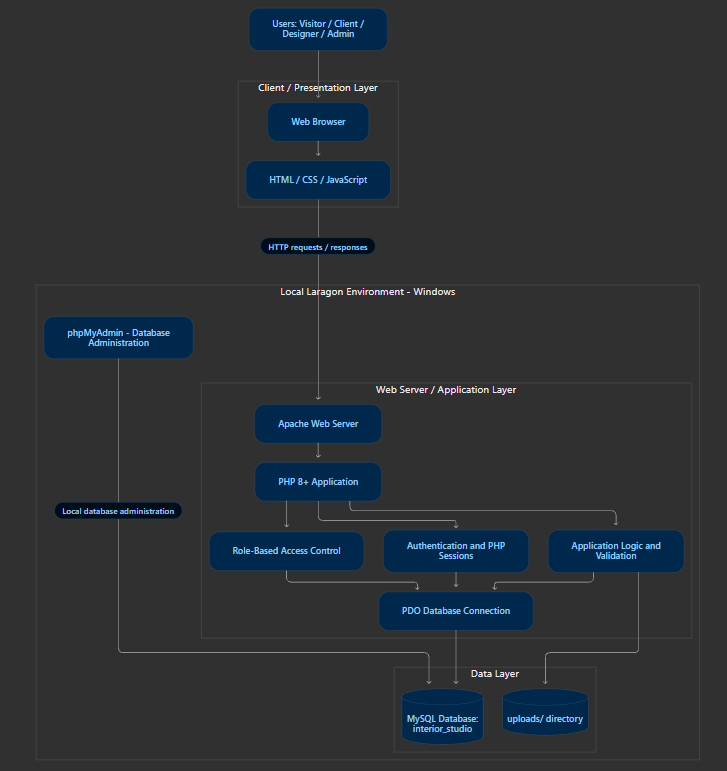

# Application architecture diagram

Logical view of the local Interior Studio application, based on the reviewed repository structure and runtime description. This is not a production deployment diagram.

## Component notes
- The browser is untrusted. Form values, URL parameters, cookies and uploaded files must be validated or verified server-side.
- Apache serves the PHP application and static resources in the local Laragon environment.
- PHP performs application logic and is responsible for enforcing authentication, permissions, validation and safe database/file operations.
- MySQL/MariaDB stores application records. The browser should not connect directly to the database.
- The uploads directory stores project images and requires appropriate filesystem permissions and server configuration.

The diagram omits implementation details that have not been independently confirmed. Update it if the architecture changes.
