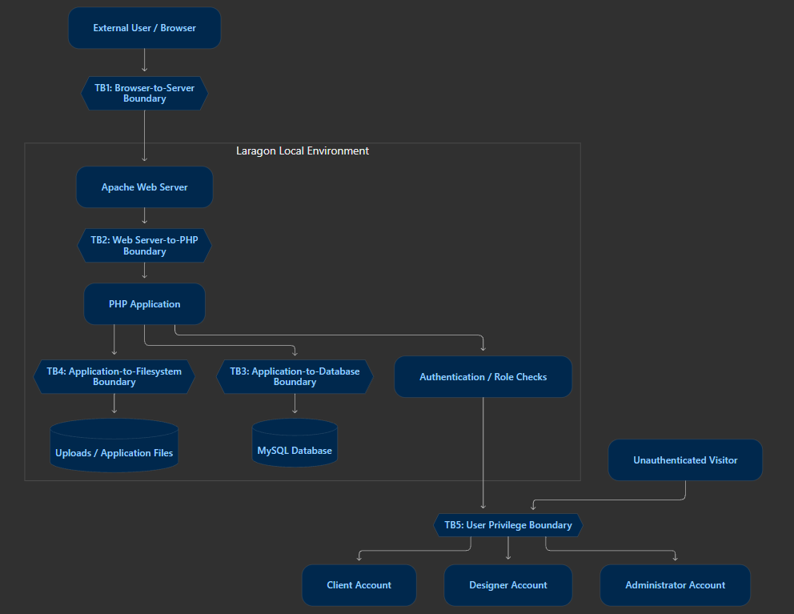

# Trust-boundary diagram

The diagram identifies where data crosses trust levels or components. These boundaries guide threat modelling and test selection.

## Trust-boundary assumptions
1. **Browser to server:** treat request data as attacker-controlled, including hidden fields, query parameters, cookies and file metadata.
2. **Authentication boundary:** a valid session identifies an authenticated user, but does not grant access to every record or function.
3. **Privilege boundary:** public, client, designer and administrator roles have different permissions. Enforce these server-side on every protected action.
4. **Application to database:** only the server-side application should access the database. Use parameterised queries and a suitably restricted database account.
5. **Application to filesystem:** validate file names, content and paths. Uploaded files must not become executable application code.
6. **Configuration boundary:** configuration and secrets must remain inaccessible to public HTTP requests and must not be committed as production secrets.
